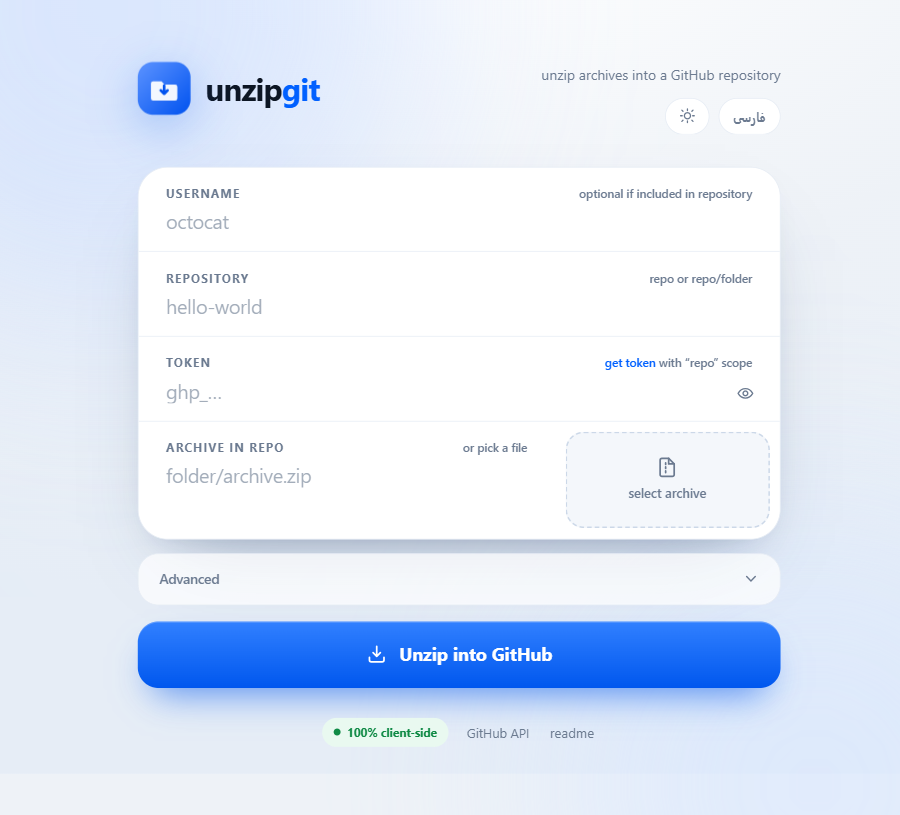

# UnzipGit

Extract a `.zip` archive straight into a GitHub repository — entirely in the browser.
A modern take on [unzipgit.github.io](https://unzipgit.github.io/): no build step, no backend,
no dependencies except a vendored copy of [JSZip](https://stuk.github.io/jszip/).




## Why it is useful

- Drop a build artifact / site archive into a repo without cloning it locally.
- Unzip an archive that already lives in the repository (handy for serverless workflows).
- Choose a target folder and branch, and commit everything in **one atomic commit**.
- Works on GitHub Pages, behind a static host, or from `file://`.

## Features

- **Client-side only** — the archive and token never leave the browser except to `api.github.com`.
- **Atomic commits** — files are uploaded as blobs, then a tree, commit and ref update
  (fast and one commit instead of hundreds).
- **Automatic fallback** — if the atomic route is blocked (protected branch, restricted token),
  files are written one by one with the Contents API.
- **Live progress** with file counts and a progress bar.
- **English / Persian UI** with full RTL support.
- **Light / dark theme**, remembered across visits.
- **Drag & drop** a `.zip`, or point at an archive already in the repo.
- Optional branch + custom commit message.
- Handles existing files: same paths are overwritten, everything else stays untouched.
- Initialises empty repositories (creates the first commit).
- Clear, translated error messages for auth, permissions, rate limits, missing branches, and bad archives.

## Quick start

```bash
# any static server works
npx serve unzipgit
# or
python -m http.server 8080 --directory unzipgit
```

Then open <http://localhost:8080> (or the port printed by your server).

### GitHub Pages

1. Push this folder to a repository.
2. Settings → Pages → deploy from the branch, root folder.
3. Open `https://<user>.github.io/<repo>/`.

A `.nojekyll` file is included so the `script/` and `style/` folders are served as-is.

## Token

Use a **classic** personal access token with the `repo` scope:

<https://github.com/settings/tokens/new?scopes=repo&description=UnzipGit>

Fine-grained tokens work too, with **Contents: read & write** on the target repository
(plus Metadata: read, which is granted by default).

The token is kept in a password field in memory only; it is never written to storage.

## Usage notes

- `repository` accepts `repo`, `repo/folder`, or `owner/repo` (and `owner/repo/folder`).
  When a username is filled in, the first segment is treated as the repo name.
- Archive source: either pick a `.zip` from your device **or** enter a path such as
  `dist/site.zip` to read it from the repo itself.
- Limits: 1500 files per run, 100 MB per archive. Big runs can hit GitHub's API rate limits.
- Executable bits from the zip (`0755`) are preserved as `100755` tree entries.
- Path traversal (`../`) and control characters in archive paths are ignored/sanitised.

## Project structure

```
unzipgit/
├── index.html          # markup + bilingual readme dialog
├── favicon.svg
├── .nojekyll
├── style/
│   └── style.css       # theme tokens, layout, RTL, responsive, animations
└── script/
    ├── jszip.min.js    # vendored library (3.10.1)
    └── app.js          # i18n, GitHub API client, upload engine, UI
```

## How the upload works

```
GET  /repos/{owner}/{repo}                     → default branch, permissions
GET  /repos/{owner}/{repo}/git/ref/heads/{b}   → head commit
GET  /repos/{owner}/{repo}/git/commits/{sha}   → base tree
POST /repos/{owner}/{repo}/git/blobs           → one blob per file (5 in parallel)
POST /repos/{owner}/{repo}/git/trees           → tree with base_tree = existing tree
POST /repos/{owner}/{repo}/git/commits         → single commit
PATCH /repos/{owner}/{repo}/git/refs/heads/{b} → move the branch
```

Fallback: `PUT /repos/{owner}/{repo}/contents/{path}` per file (sequential), fetching the
existing `sha` when a file has to be overwritten.

## Customising

- Colours, radii and shadows live in the `:root` / `[data-theme="dark"]` blocks of `style/style.css`.
- Translation strings live in the `STRINGS` object at the top of `script/app.js`.
- To point the footer at your own repo, edit the `footer` markup in `index.html`.

## License

MIT — use it, fork it, ship it.
